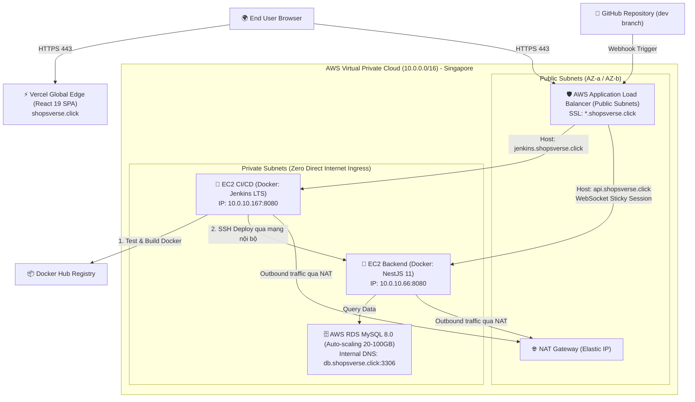

# 🏢 F-Corp-OS (Enterprise Talent & Project Operating System)

<p align="center">
  
  
  
  
  
  
  
  
  
</p>

---

## 📌 Giới Thiệu Tổng Quan (Overview)

**F-Corp-OS** là nền tảng quản trị tổng thể doanh nghiệp công nghệ cao cấp, tích hợp giữa **Quản trị Dự án Agile (Sprints & Tasks)**, **Hệ thống Quản lý Năng lực (Skill Tree & Matrix)**, **Đánh giá Nhân sự (HR Reviews & Wallets)** và **Tương tác Thời gian thực (Real-time Chat & Notifications)**.

Hệ thống được thiết kế theo tiêu chuẩn Enterprise với kiến trúc Multi-Tier Cloud trên **AWS (Singapore Region `ap-southeast-1`)**, tự động hóa toàn diện từ mã nguồn hạ tầng (**Terraform**) đến luồng triển khai liên tục (**Jenkins CI/CD**).

---

## 🏛️ Kiến Trúc Hệ Thống (Cloud Architecture)

Dự án áp dụng mô hình bảo mật nhiều lớp (**Defense-in-Depth**) trong **Custom VPC**:



---

## ✨ Tính Năng Nổi Bật (Key Features)

| Phân hệ | Tính năng cốt lõi | Công nghệ chủ đạo |
| :--- | :--- | :--- |
| **Project & Sprint** | Quản lý dự án, lập kế hoạch Sprint, phân rã Task, sơ đồ phụ thuộc công việc (Task Dependencies). | NestJS, TypeORM, React Flow |
| **Skill Management** | Bản đồ cây kỹ năng (Skill Tree), tải minh chứng năng lực (Evidence), duyệt thăng cấp kỹ năng. | `@xyflow/react`, TypeORM |
| **HR Analytics** | Bảng phân tích ma trận kỹ năng (Skill Matrix), quản lý nhân sự bench, review định kỳ, ví thưởng/phúc lợi. | Recharts, Ant Design |
| **Realtime Collab** | Nhắn tin dự án trực tiếp (Chat), thông báo tức thời qua WebSockets. | Socket.IO, WebSocket Adapter |
| **RBAC Security** | Hệ thống phân quyền chặt chẽ theo vai trò (`ADMIN`, `HR`, `PM`, `DEVELOPER`) kèm JWT Cookie/Header. | Passport, JWT, Guards |

---

## 🛠️ Công Nghệ Sử Dụng (Tech Stack)

### **Frontend**
* **Framework**: React 19 (Vite 6) + TypeScript
* **State Management**: Redux Toolkit (`@reduxjs/toolkit`)
* **UI Components**: Ant Design (Antd 6), React Icons
* **Data Visualization & Flow**: Recharts, `@xyflow/react` (React Flow)
* **Real-time Client**: `socket.io-client`
* **Hosting**: Vercel

### **Backend**
* **Framework**: NestJS 11 + Express + TypeScript
* **ORM & Database**: TypeORM + MySQL 8.0 (AWS RDS)
* **API Documentation**: Swagger OpenAPI 3.0 (`/api`)
* **Real-time Engine**: `@nestjs/websockets` + Socket.IO
* **Containerization**: Docker Multi-stage Build (Alpine Node 20)

### **Cloud Infrastructure & DevOps**
* **IaC**: Terraform 1.10+ (VPC, Subnets, IGW, NAT Gateway, ALB, ACM, Route 53, RDS, EC2)
* **CI/CD**: Jenkins LTS (Official Docker Container với Docker-in-Docker socket)
* **Registry**: Docker Hub
* **DNS & SSL**: AWS Route 53 + AWS Certificate Manager (ACM) Wildcard SSL (`*.shopsverse.click`)
* **Management**: AWS Systems Manager (SSM) Session Manager (Không cần mở cổng SSH ra Public)

---

## 📁 Cấu Trúc Thư Mục (Repository Structure)

```text
F-Corp-OS/
├── backend/                  # NestJS 11 Server Application
│   ├── src/
│   │   ├── modules/          # Auth, Users, Roles, Projects, Sprints, Skills, HR...
│   │   ├── websockets/       # Socket.IO Gateway & Adapter
│   │   ├── database/         # Data source & TypeORM entities
│   │   └── main.ts           # Global prefix 'api', Swagger, CORS
│   ├── Dockerfile            # Multi-stage production build (Node 20 Alpine)
│   ├── docker-compose.yml    # Production compose config
│   └── package.json
│
├── frontend/                 # React 19 SPA Application
│   ├── src/                  # Redux stores, Pages, Flow diagrams, Antd views
│   ├── vercel.json           # Vercel SPA client routing configuration
│   └── package.json
│
├── terraform/                # Toàn bộ mã nguồn AWS Infrastructure as Code
│   ├── modules/
│   │   ├── vpc/              # Multi-AZ VPC, NAT Gateway, Route Tables
│   │   ├── security_groups/  # Tường lửa phân tầng chuẩn Enterprise
│   │   ├── acm/              # Tự động xin cấp & xác thực SSL Certificate
│   │   ├── alb/              # Application Load Balancer & Routing rules
│   │   ├── rds/              # MySQL 8.0 RDS với Auto-scaling Storage
│   │   ├── dns/              # Route 53 Public & Private Hosted Zones
│   │   └── ec2/              # Backend & Jenkins EC2, IAM Role, SSM Profile
│   ├── main.tf
│   ├── outputs.tf
│   └── terraform.tfvars.example
│
├── Jenkinsfile               # Declarative Pipeline tự động hóa CI/CD
└── README.md
```

---

## 🚀 Hướng Dẫn Cài Đặt & Chạy Cục Bộ (Local Setup)

### 1. Yêu cầu môi trường
* Node.js >= 20.x
* Docker & Docker Compose
* MySQL >= 8.0 (hoặc chạy qua Docker)

### 2. Khởi chạy Backend
```bash
cd backend
npm install

# Tạo file .env cục bộ từ file mẫu
cp .env.example .env
# Điền DATABASE_HOST=localhost, DATABASE_USER, DATABASE_PASSWORD...

# Khởi chạy chế độ phát triển
npm run dev
```
> Swagger API Documentation sẽ hoạt động tại: `http://localhost:8080/api`

### 3. Khởi chạy Frontend
```bash
cd frontend
npm install

# Tạo file .env từ file mẫu
cp .env.example .env
# VITE_BACKEND_URL=http://localhost:8080/api/v1
# VITE_SOCKET_URL=http://localhost:8080

# Chạy dev server
npm run dev
```

---

## 🔄 Quy Trình CI/CD Tự Động (Jenkins Pipeline)

Mỗi khi lập trình viên thực hiện `git push` lên nhánh `dev`:

1. **GitHub Webhook** gửi tín hiệu HTTP POST tới `https://jenkins.shopsverse.click/github-webhook/`.
2. **Jenkins Pipeline** tự động kích hoạt:
   * **Stage 1 (Checkout Code)**: Kéo phiên bản mới nhất từ nhánh `dev`.
   * **Stage 2 (Backend Verification & Build)**: Kiểm tra TypeScript compilation bằng `nest build`.
   * **Stage 3 (Build Docker Image)**: Đóng gói Docker image `longlephanhai/fcorp-backend:${BUILD_NUMBER}` và `:latest`.
   * **Stage 4 (Push to Docker Hub)**: Đăng nhập và đẩy image lên Docker Hub.
   * **Stage 5 (Deploy to EC2 Backend)**: SSH qua mạng Private VPC (`10.0.10.66`), cập nhật file `docker-compose.yml`, pull image mới và kích hoạt container không gián đoạn dịch vụ (`zero-downtime`).
   * **Database Auto-Sync**: TypeORM tự động đồng bộ Schema và khởi tạo dữ liệu mẫu khi container khởi động.

---

## ☁️ Triển Khai Hạ Tầng Bằng Terraform

Chi tiết toàn bộ quy trình thiết lập và quản lý tài nguyên AWS được tài liệu hóa chi tiết tại:
👉 [**Hướng dẫn chi tiết Terraform IaC**](file:///home/long/F-Corp-OS/terraform/README.md)

### Tóm tắt lệnh quản trị:
```bash
cd terraform

# 1. Khởi tạo plugin
terraform init

# 2. Xem trước kế hoạch triển khai
terraform plan --var-file="terraform.tfvars"

# 3. Triển khai toàn bộ hạ tầng
terraform apply --var-file="terraform.tfvars" -auto-approve

# 4. Dọn dẹp tài nguyên khi kết thúc thử nghiệm (tránh phát sinh chi phí)
terraform destroy --var-file="terraform.tfvars" -auto-approve
```

---

## 🔒 Quản Trị Bảo Mật (Security & Credentials)

* **Không lưu trữ Secret trong mã nguồn**: Toàn bộ file nhạy cảm (`*.pem`, `*.tfvars`, `.env`) đều được bảo vệ trong `.gitignore`.
* **Zero Open Ports**: Các máy chủ EC2 nằm trong Private Subnets, không có Public IP và không mở cổng SSH ra Internet. Quản trị viên kết nối an toàn qua **AWS SSM Session Manager** hoặc mạng nội bộ.
* **Database Isolation**: AWS RDS MySQL chỉ chấp nhận kết nối nội bộ từ Security Group của Backend EC2.

---

## 👥 Đội Ngũ Phát Triển (Team)

* **Repository**: [https://github.com/longlephanhai/F-Corp-OS](https://github.com/longlephanhai/F-Corp-OS)
* **Lead / DevOps**: Lê Phan Hải Long
* **License**: MIT / Proprietary Project
